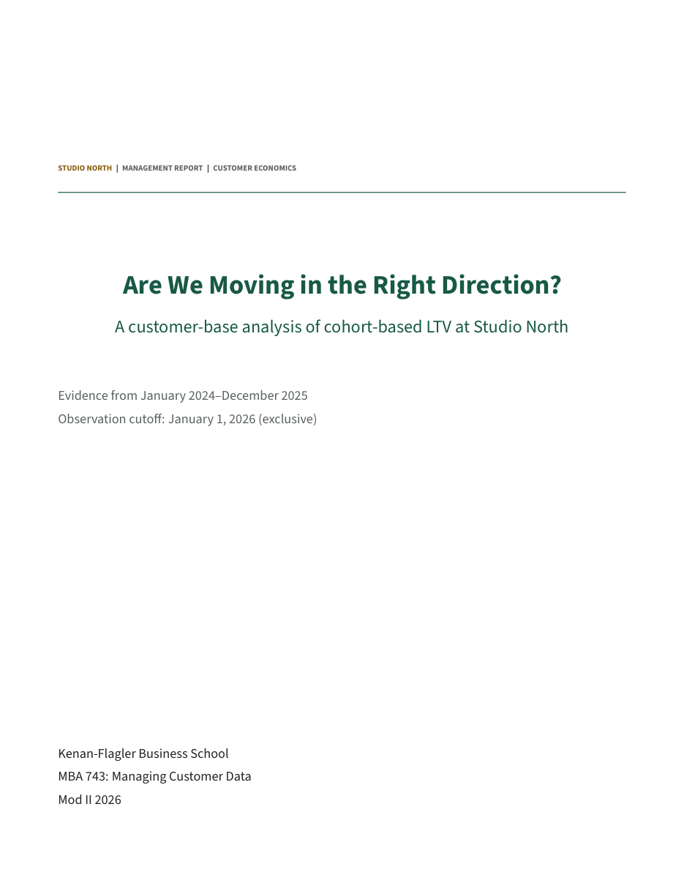

# Customer Economics Lab

**Are we moving in the right direction as a company?**

[Read the executive report](examples/reference/report/customer-economics-report.pdf) · [Companion slides: PDF](teaching/customer-economics-lab.pdf) / [PowerPoint](teaching/customer-economics-lab.pptx) · [Stage-gated skill](SKILL.md)

This framework starts with eight separate source-system CSVs and ends with an executive decision report and an auditable analytical handoff. The fictional business, Studio North, sells monthly creative-work memberships. Twenty-four acquisition cohorts make monthly renewal decisions; customers differ in their underlying propensity to churn. Managers can use the same staged workflow to brief their analytical teams.

In one AI-agent chat, students inspect the exports, classify each dataset's Universal Customer View fields, execute saved DuckDB SQL, compare cohorts and segments, examine randomized acquisition evidence, and forecast immature cohorts. The main NumPyro model uses heterogeneous-churn sBG retention and Gamma revenue. An adapted Orduz Bayesian neural network is a separate validation comparison. The actual report-formatting skill and source assets are bundled, along with Archify relationship diagrams and editable LaTeX/PDF output.



## Start in Codex

Paste this request into a local Codex chat:

> Download the public repository https://github.com/longxiutian/customer-economics-lab as a ZIP over HTTPS, preferably the v6.0.1 release. Do not install Git or ask me to create a GitHub account. Extract it into a new working folder, read SKILL.md, and help me complete setup. Run the framework one stage at a time. Stop after each stage and wait until I explicitly say “next.”

You can also use GitHub's **Code → Download ZIP**, extract it, and ask Codex to read `SKILL.md` in that folder. The repository does not need to be installed as a global skill. Its bundled supporting diagram package does not require Git either.

Complete [setup](docs/setup.md) before the class. The core requirements are Python 3.12, the frozen `uv.lock` environment, Node 20+, the pinned browser renderer, and a supported LaTeX engine. DuckDB reads the CSVs locally; there is no database server or paid cloud account to configure.

## Guided commands

Run commands from the extracted repository:

```text
uv sync --frozen
uv run --frozen python lab.py start
uv run --frozen python lab.py message "next"
uv run --frozen python lab.py status
```

`start` runs setup only. Each explicit `next` advances one stage. Questions and corrections do not advance. Progress, source hashes, and learner choices live in `outputs/guided/lab_state.json`, so another chat can resume the same folder.

Save your own interpretation without advancing:

```text
uv run --frozen python lab.py choose provisional_verdict "Growth is improving, but the newest cohort is still immature."
```

Changing a judgment invalidates dependent stage records and archives stale outputs. Modified frozen CSVs fail validation; the lab does not silently use them.

After stage 3, ask a natural-language question about the data. Codex can write and execute a single read-only SQL query through the logged helper:

```text
uv run --frozen python lab.py query --sql-file my-question.sql
```

For example, `SELECT cohort_month, n_acquired, cac FROM cohort_six_month_comparison ORDER BY cohort_month` examines comparable older cohorts. The helper saves the exact SQL, input hashes, full bounded result CSV, and receipt under `outputs/guided/queries/`. Questions never advance the guided stage. Writes, external file/network reads, and multiple statements are rejected; oversized results require a narrower query. A verified instructor batch output can be explored with `query --instructor` and the corresponding `--output` option.

## The eight stages

0. Check readiness and understand the company question.
1. Inspect separate source files and draw the system map.
2. Classify UCV fields and propose baseline customer segments.
3. Build cohort views through saved DuckDB SQL.
4. Compare cohort trajectories, segmentation, and company growth.
5. Check acquisition incrementality with experiments.
6. Forecast immature cohorts and examine LTV/payback.
7. State a supported company verdict and compile the report.

Use the [business brief](docs/business_brief.md), [data dictionary](docs/data_dictionary.md), and [sources](docs/sources.md) as references. The final report separates observed evidence, forecasts, assumptions, and the learner's recommendation.

See [version 6 changes](docs/v6-changes.md) for the segmentation objective and acquisition-cost reconciliation, and [CAC and LTV methodology](docs/cac-incrementality.md) for the course connections. The earlier [version 5 changes](docs/v5-changes.md) describe journey diagnostics, strategic breakouts and report replay without refitting.

## Instructor reproducibility

The frozen observed data release is version **4.0**. Its manifest records every CSV's hash, definitions and observation cutoff. Data generation and the next twelve calendar months of evaluation outcomes belong to a separate instructor-only workflow outside this repository. The public analysis starts from the frozen exports; DuckDB SQL produces the analytical tables, and plotting and reporting consume those results. Reproducibility after data release does not require access to the private generator.

For an explicitly requested full reproducibility run:

```text
uv run --frozen python lab.py --output outputs/instructor batch --instructor
uv run --frozen python -m pytest
uv run --frozen python scripts/verify_reproducibility.py --output outputs/replay-check
```

Batch mode intentionally runs all computations and is not the student-chat workflow. Choose a fresh empty output folder for each run. Use `--no-pdf` before the command only when an editable TeX result is intentionally sufficient. A different model step budget or seed is recorded and invalidates dependent guided outputs. Changes to core code, SQL, templates, or the frozen environment fail closed in an existing guided session; restore the release or begin a new output folder.

The default main-model budget gives four NUTS chains 1,000 warmup iterations and 1,000 retained draws each. The separate neural-network comparison uses 10,000 SVI steps. Read the [model specification](docs/model-specification.md), and [model review](docs/model-review.md) for assumptions, historical validation, and the limits of the uncertainty bands. The [bundled report skill](skills/executive-report/SKILL.md) specifies the executive narrative and required parameter, validation and data appendices.

Use [the local Orduz reading](assets/articles/orduz-2024-cohort-revenue-retention/orduz-source-notebook.pdf), the eight UCV field tables, the introductory business experience map, and the knowledge-assets diagram as part of the workflow. The optional [model challenge](docs/model-challenge.md) forecasts the next twelve calendar months; future outcomes are not distributed.

Use **uv** for all Python package management and execution. The baseline and neural comparison run on **CPU**; no GPU or CUDA installation is required.

The original code, synthetic data, and teaching materials use the repository's MIT license. Bundled third-party components retain their own licenses. The archived Orduz source-notebook reading carries its own author license and provenance under `assets/articles/`; other sources are cited separately.
