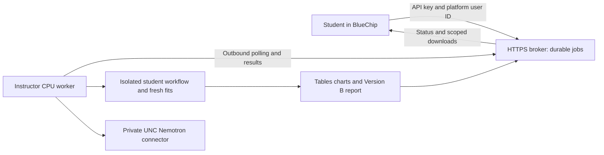

# BlueChip browser scenario

The instructor selected this additional scenario on November 7, 2026. It preserves the local coding-agent route and the separate personal-ChatGPT distribution plan. The student experience is one BlueChip agent link, organization sign-in, and nineteen checkpoints paced by the student's own `next step` messages. Students install nothing.

**Deployment status: a working November 7 instructor pilot.** [Open the guided BlueChip agent](https://bluechip.kenan-flagler.unc.edu/chat/959a9b88-8e0a-4598-ba27-f8f2e6cfe602) and select **Start my Studio North lab**. Its sharing setting is “Anyone with link in my organization.” The bounded service ends November 7, 2026 at 17:15:56 America/New_York. The full lesson uses the prepared backend because the portal sandbox lacks the released Python/JAX/NumPyro/DuckDB/TeX toolchain. Two complete API rehearsals and the real BlueChip opening/question/choice/resume flow passed. A second real student's entitlement, shared-agent use-only permissions and whole-class capacity remain separate acceptance checks; this is not a November 16 deployment.

## Components and ownership

The broker is a separate Sites/Cloudflare Worker source repository, with D1 job records and R2 artifacts. Its project is `appgprj_6aef59b1a59c81918ca26cc623cca883`; the verified origin is `https://studio-north-bluechip-lab.blondeflour1.chatgpt.site`. Deployment 5 uses source commit `c594c5dc42bd2ddff976fcd343402a07935888ab`. The landing page and signed download route are public; calculation and worker routes retain application authorization. Record later saved versions, source commits and deployment results separately.

The canonical lab remains this repository. `cohort_lab/hosted.py` wraps `StudentWorkflow`; `hosting/bluechip_worker.py` polls jobs and runs that adapter in the locked environment. `hosting/nemotron_interpret.py` invokes a maintained operator connector in an isolated process. It accepts no model address or credential from the learner. BlueChip's interface model is distinct from Nemotron, and actual model responses carry identity, timestamps, usage and an evidence hash.

## Identity, state and transport

Configure the API tool using `hosting/bluechip-tool-schema.json` and `hosting/bluechip-agent-instructions.txt`. Use POST `/api/lab`, a fixed `X-Studio-North-Key`, and header `X-BlueChip-User` set with BlueChip's **User Email** merge tag, `{{CurrentUserEmail}}`. The November 7 live diagnostic verified this tag was populated; the exposed `{{CurrentUserObjectId}}` tag arrived empty. The broker accepts UNC addresses and immediately derives a keyed hash, without storing the raw address. Verify substitution on each deployment. Never let the model supply an email, owner or filesystem path as authorization.

The broker authenticates the agent credential and HMACs the platform identity before storing a workspace key. The agent credential and worker credential are different. An API key plus a forwarded platform tag is delegated platform identity, not independent verification of an OIDC token. The key must remain in the agent's private tool configuration; confirm that shared-agent users cannot retrieve or edit it before classroom release. The landing page can serve signed output links without a second ChatGPT login while calculation and worker routes retain their separate authorization. Signed links expire within thirty minutes and no later than the session expiry. They are bearer links: anyone receiving a valid link can download that particular artifact until expiry; changing its run or artifact invalidates the signature.

Each owner gets one run in the pinned session. Each mutation requires a new request ID and expected revision. A retried ID returns its prior job; changed content with the same ID is rejected. One active job per owner is enforced in storage. An active fit survives browser disconnection. Stale revisions do not advance. Jobs with expired worker leases become interrupted and require operator reconciliation; they are never automatically fitted again.

Private Sites also require their service-access header for server callers. Public student downloads require a supported audience and a tested browser route. Do not expose the model or compute ports, use a blocked tunnel through another proxy, or put service credentials in a download URL. Application download links are separate short-lived HMAC capabilities for a specific run and artifact; protect them like the report they authorize. They never contain model or broker keys.

## Reproduce the worker

1. Freeze an instructor execution copy of this release, its eight CSVs, licensed assets, `uv.lock`, Node lock and templates. Capture `release_manifest()` and source commit/dirty-file hashes. Keep an active development checkout separate; edits to instructions, sources or locks invalidate the old release instead of rewriting manifests.
2. Prepare Python 3.12 with `uv sync --frozen`; use the frozen interpreter for jobs. Prepare the pinned diagram renderer and documented LaTeX engine. The deployed worker can invoke that already-created interpreter directly; it must not install packages while serving students.
3. Keep an operator JSON configuration outside Git. Required fields: `broker_url`, `worker_key`, `worker_id`, `runtime`, `release_hash`, `expires_at`. Private Sites add `sites_service_token`. Optional `interpreter_command` is an operator-chosen argument array calling `hosting/nemotron_interpret.py --connector <maintained connector.py>` with the connector's Python environment; `model_status_path` points to its non-secret health receipt. Restrict credential-file access to the operator.
4. Set broker runtime variables through its host: `LAB_AGENT_KEY`, `LAB_WORKER_KEY`, `LAB_IDENTITY_KEY`, `LAB_DOWNLOAD_KEY`, `LAB_RELEASE_HASH`, `LAB_EXPIRES_AT`, `LAB_MAX_WORKSPACES`. Never commit values or send them to students.
5. Launch `uv run --frozen python hosting/bluechip_worker.py --config <operator-config>` through the maintained no-console supervisor on Windows. That supervisor places the full process tree in a kill-on-close Job Object. Python children use `CREATE_NO_WINDOW`; no detached console or unowned background process is permitted. Set a session deadline; the November 7 debugging authorization is five hours, not a recurring service or a November 16 reservation.
6. Preserve `runtime/workspaces/<run>/lesson`, `receipts`, `release.json`, and `spool/<job>`. Completed job receipts return their existing result. A failed upload preserves the result for deliberate redelivery; never delete its receipt to force execution again. A computation with an uncertain outcome requires reconciling the canonical lesson state before retry.

The worker currently admits one job at a time. This is an instructor integration configuration, not a claim of classroom throughput. The broker returns status without waiting for the CPU. Profile fitting and queueing, then separately approve/test appropriate parallel CPU workers and GPU serving capacity.

## Evidence and teaching requirements

Keep the root and student-teacher skills authoritative. An exact standalone `next step` advances once; questions, SQL exploration and saved judgments do not. The backend logs the received learner message. A model-generated API argument is not independent proof that a person typed it, so browser acceptance must verify that the configured agent forwards genuine turns and does not fabricate consent.

Artifacts come only from the current workspace and the checkpoint's explicitly allowed released readings. UCV exposes all eight field tables; acquisition evidence includes all six monthly test waves. Each learner executes the released CPU float64 model at checkpoint 14, with a per-job fresh-execution receipt and hashes. Sharing an installed environment is allowed; substituting another learner's posterior is not.

Checkpoint 18 requires the learner's own verdict and action, builds Version B from their saved outputs, and verifies lesson completion, a matching fresh-fit receipt, readable PDF and editable source. The automated receipt explicitly distinguishes these checks from a human visual inspection. Failed Nemotron interpretation does not erase a completed calculation; it is labeled unavailable, never replaced by falsely attributed prose.

## Acceptance record

Save actual receipts outside the immutable release; do not edit this contract mid-run to update a result. The handoff must report:

- broker build, migration, deployed version and access mode;
- two isolated learner identities, rejected cross-user jobs, run-scoped signed downloads, stale revisions, duplicate requests, restart/resume and expiry;
- a full fresh 19-checkpoint instructor rehearsal with actual choices clearly labeled test inputs, PDF and source downloads;
- a BlueChip-originated status/start/question/next-step/choice sequence and verified merge-tag identity;
- actual Nemotron model/revision, allocation, expiry and an interpretation grounded in returned lab evidence;
- a second real BlueChip user and class-size/consecutive-section tests before calling the route classroom-ready.

The five-hour development GPU allocation and private instructor smoke tests cannot stand in for class-day provisioning or student entitlements.

### November 7 observed results

- Two isolated instructor fixtures completed all nineteen checkpoints, saved explicit test judgments, executed their own CPU fits, and downloaded the PDF and editable TeX. Both generated the same 45-page PDF SHA-256: `ff3b5bdacc3f799ccf5dc2ee43545edcd32a0cf2b58ad66e462043204c88abf7`. All 45 rendered-page hashes also matched. The fitted seed and inputs were identical; receipts establish that the executions were separate.
- Fresh statistical execution took 422 and 412 seconds. Both used CPU float64, four chains, 1,000 warmup and 1,000 retained draws per chain; each had zero divergences, maximum R-hat 1.00182 and minimum ESS 950.10. Forty checkpoint/question interpretations completed through the actual Nemotron deployment, with no unavailable responses in these corrected runs.
- The real BlueChip account forwarded a substantive question verbatim, advanced once for an exact `next step`, saved the supplied hypothesis without advancing, and resumed the same checkpoint and judgment in a new chat. The updated interface displays the actual journey PNG inline. Live interface prompt version 4 is recorded separately from the immutable CPU release.
- Live checks rejected another owner's job and a stale revision, verified a signed PDF download without Sites sign-in, rejected altered/expired download URLs, and recovered from a failed read-only SQL query at the unchanged checkpoint. Final validation still matched the original fresh-fit receipt.
- The PDFs have no unresolved-reference markers, empty text pages or “MBA 743” label; their fonts are embedded. Visual inspection covered every page in a contact sheet and full-size cover, learner recommendation, holdout, cost/value, schema and skill-workflow pages. The two identical PDFs share these findings.

The current CPU worker runs on the instructor's Windows computer, which must remain awake and connected. It executes one job at a time. The broker is hosted remotely and Nemotron runs on Longleaf. The GPU is the unedited `nvidia/NVIDIA-Nemotron-3.5-Super-VL-120B-A12B-NVFP4` revision `da5b2650a835292c678994a1fa3fb653250fb508`, under the Longleaf Local LLM chat's bounded allocation. Full completion was tested through the real broker API; the browser test covered the opening checkpoints and interaction contract, not a second manual walk through all nineteen checkpoints.

The operator record is `studio-north-bluechip-20261107/deployment-record.json`, with `acceptance-02/completed-verification.json`, both run summaries, rendered QA evidence, source archives and the frozen execution manifest. CPU release fingerprint: `5875124b8a78cb3bb7f965c852c9843aa2fdcfee928b2024f8c461081bc3effd`. Keep these dated results distinct from later deployments.

## Guided-artifact regression found during integration

The November 7 full rehearsal exposed two exhibits that had only been generated by the final report path: the monthly iCAC-history chart and incremental-cash comparison. Their shared rendering functions now also run at the appropriate pre-report computational stages. The acquisition-only history needs no fitted value; the cost/value chart requires the verified fitted outputs. The final report reuses the same functions. The original failed workspace and release remain preserved; corrected code starts a fresh pinned workspace instead of rewriting an old integrity manifest.

For the current Nemotron deployment, use its verified native WSL Python and the connector's returned client (each connection owns a distinct ephemeral loopback port). Interpretation uses a 900-token cap, thinking disabled, a 75-second SDK I/O timeout and a 150-second overall subprocess bound. The pipeline stores private failure details and labels missing responses as unavailable. These are debugging settings, not a class-capacity guarantee.
