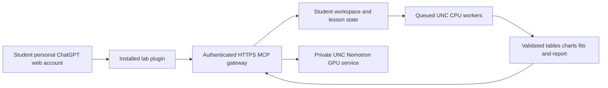

# Studio North classroom access from personal ChatGPT accounts

**November 7 update:** BlueChip is an additional instructor-selected scenario; see [its backend and acceptance contract](bluechip-classroom.md). The personal ChatGPT distribution plan below remains separate.

Status on November 5, 2026: **deployment plan; the classroom connection is not implemented or accepted**. Longxiu confirmed that students will use personal ChatGPT accounts. Their subscription tiers and custom-plugin permissions are unknown. The classroom must work from ChatGPT web and the UNC network, without student-installed software, Platform keys, Longleaf accounts, or an assumed paid subscription.

The recommended design is one instructor-managed, authenticated lab plugin backed by a stable HTTPS MCP gateway. The gateway connects to private UNC model serving and a separate CPU execution service. Each authenticated student receives an isolated workspace and fresh statistical fits. Public plugin distribution and access from representative personal accounts must be demonstrated before this becomes the classroom route.

## What is established

| Component | Evidence and remaining work |
|---|---|
| Analytical workflow | This repository implements eight computational stages and nineteen guided checkpoints. The inspected starting revision is `3e898bb`; a classroom deployment must freeze its exact final source and dependency locks. |
| Personal model pilot | The upstream handoff reports successful authenticated workstation Python and MCP generations using unchanged Nemotron 3.5 Super VL base weights. That verifies the private workstation path. |
| ChatGPT account connection | The instructor's ChatGPT account pairing and an actual web-originated tool call remain unverified. Installed tunnel software is not proof of a paired account. |
| Personal tool capabilities | `pilot_status`, `connect_model`, `nemotron_generate`, and `saved_results` provide status, text generation and retained evidence. They do not expose the lab's computation or lesson controller. |
| Classroom tools | Authentication, isolated learner state, asynchronous fresh fits, artifact delivery, and full workflow validation still need implementation. |
| Capacity | The retained earlier rehearsal verified 39 of 45 complete workflows. It used 45 synthetic Codex clients on one workstation, six CPU admission slots, and an older public revision. It did not test 45 ChatGPT web accounts. |

The current personal GPU pilot expires on November 5 and is not a November 16 reservation. Its existing controller continues to own observation. This plan neither changes that allocation nor authorizes another allocation, changes to research jobs, publication, or contact with students or administrators.

## Personal-account access is the first acceptance gate

An institution's workspace publication does not grant access to students who remain in their personal accounts. The official packaging guide explicitly keeps workspace-published plugins within that organization. A GitHub marketplace or local MCP configuration also does not establish a ChatGPT web connection. [OpenAI packaging guidance](https://developers.openai.com/plugins/build/plugins)

Use this order of investigation:

1. Test whether the actual instructor account offers a supported sharing route that a separate personal account can install and use. A visible share link is insufficient: the recipient must make an authenticated tool call. Personal cross-account sharing is not established by the sources reviewed here.
2. The documented broad-distribution route is a reviewed public plugin. Its remote MCP connection needs a stable public HTTPS endpoint; after approval, the owner chooses when to publish. Public discoverability can coexist with roster-restricted access enforced by the lab service. Review timing is an external dependency, not a promised completion date. [OpenAI submission guidance](https://developers.openai.com/plugins/deploy/submission)
3. Verify the proposed route with a personal Free account and representative paid accounts, including installation, OAuth, required read/write tools, message limits during an 80-minute lesson, reconnect, and an actual artifact download. Current general documentation does not establish universal custom-plugin access for the student accounts. A successful instructor Pro-account test cannot stand in for this check. [OpenAI custom MCP setup](https://developers.openai.com/api/docs/guides/custom-mcp-server)

Do not make every student create a custom MCP server or Platform tunnel. Those are conditional developer options, with account permissions of their own. Do not require purchases to resolve an eligibility failure.

If personal-account access cannot be qualified in time, surface the constraint to Longxiu. A UNC-hosted browser lab could reuse the same backend and still avoid installations, but it would change the requested ChatGPT-only interface. It is a fallback for a separate decision, not an equivalent already-delivered route.

## Connection and identity

The proposed classroom path is:

The public component is the authenticated gateway, not an unauthenticated model port. A persistent service host owns the gateway, job records and artifact access; transient GPU allocations supply model inference. Hosting, domain ownership, TLS, UNC identity integration and approved CPU capacity must be assigned before deployment. No such endpoint or identity registration has been provisioned by this plan.

Prefer a lab OAuth integration with an approved UNC identity provider. A student's personal ChatGPT email need not be their UNC identity: the OAuth connection establishes the authorized learner. Validate tokens and derive the workspace owner from the authenticated subject. Check ownership on every state, job, query and artifact request. A name, email, run ID or filesystem path supplied in a prompt cannot grant access. [OpenAI authentication guidance](https://developers.openai.com/plugins/build/auth)

The personal pilot's no-authentication MCP layer and shared service identity are insufficient for this multiuser requirement. Keep model and infrastructure credentials on the server. Use course enrollment controls and per-student quotas; expose no arbitrary shell, Slurm administration or credential-reading tools.

Secure MCP Tunnel remains an option for the personal test or a separately verified eligible distribution route. One central host can poll outbound to OpenAI and reach the private service; students do not run tunnel clients. Tunnel association and permissions still depend on the calling organization/workspace. OAuth authorization endpoints need their own reachable route. The documented tunnel budget is 120 seconds per request, with a 10 MiB envelope and a shared default request limit of 600/minute. Therefore jobs must return quickly and continue asynchronously. These transport limits are not a capacity guarantee. The public-plugin submission route currently documents a public HTTPS endpoint, so do not assume the personal tunnel can simply be published to all personal accounts. [Secure MCP Tunnel](https://developers.openai.com/api/docs/guides/secure-mcp-tunnels)

## Required classroom tools

These names define a proposed interface, not tools available today. Implement wrappers around the repository's real functions, retaining the analytical contracts and state invalidation rules.

| Proposed capability | Required behavior |
|---|---|
| `lab_status` | Return authentication state, service readiness/expiry, pinned code/data/lock hashes, actual model identity and capabilities. Distinguish model-ready from lab-ready. |
| `lab_start` | Create or resume the authenticated student's workspace at the opening checkpoint; return a non-secret run ID and current state. |
| `lab_message` | Receive the actual learner message plus expected state revision and idempotency key. A standalone `next step` may request exactly one transition. Questions never advance. |
| `lab_choose` | Store only the learner's actual allowed judgments; preserve the existing rewind rules when they change. |
| `lab_job_status` | Return queued/running/failed/completed execution state and separate validation state. Repeated calls inspect the same job. |
| `lab_query` | Run the existing bounded read-only SQL exploration against that learner's available verified tables; return SQL and evidence receipts. |
| `lab_interpret` | Retrieve authorized evidence and call UNC Nemotron. Return the actual model response, identity and evidence references, clearly distinguished from computed values. |
| `lab_artifact` | Return actual tables, chart images and authenticated downloads belonging to the run. Keep large files outside tool response envelopes. |
| `lab_validate` | Check lesson completion, genuine saved judgments, fresh fit receipts/diagnostics and report provenance before declaring completion. |

The backend must serialize mutations per learner and reject stale state revisions. A repeat of one request returns the existing transition/job instead of creating another. While a checkpoint job is active, another `next step` returns that job's status instead of submitting duplicate work or advancing. Bind each accepted advance to the current checkpoint and the retained learner message. A tool argument containing `next step` is not independent proof that a human typed it; the orchestration must preserve the real message, and the browser acceptance test must exercise questions, ambiguous replies, retries and fabricated-consent attempts.

Keep inference and statistics separate. ChatGPT controls the interface; Nemotron interprets supplied evidence on the GPU; deterministic SQL, model fitting and report generation execute on CPU workers. The plugin does not replace the model selected in ChatGPT. A Nemotron response is interpretation, not proof that code ran.

## Fresh fits and the existing teaching steps

Reuse the [checkpoint map](student-workflow.md), including the opening at 0, SQL at 6, acquisition tests at 12, explanation at 13, fitting/validation at 14, recommendation at 17 and report at 18. The root skill remains the analytical contract; the student-teacher skill owns pacing; the report skill owns the final document.

For each student, save the exact source revision, input hashes, environment/lock hashes, model specification, sampling settings, seed, execution timestamps, diagnostics, posterior hashes and report manifest. Running independently may reproduce another run's numbers when seeds and inputs match; identical numbers alone neither prove nor disprove freshness. Freshness requires an actual execution receipt tied to that student's job. Never replace the computation with another student's posterior or the packaged reference result.

Workers may reuse installed packages, read-only source assets, and validated compiled kernels. They must preserve the released CPU float64/sequential-chain specification and sampling budgets. Use separate writable workspaces and bounded resource allocations. A hosted session that disconnects resumes its existing job and outputs. A failed computation stays at the same checkpoint; retrying requires a new genuine learner advance under the existing protocol.

At the final checkpoint, compile from the student's validated outputs and saved recommendation. Check the PDF/TeX and source-evidence relationship as well as file existence. Supply a real authenticated browser download and inline chart delivery. A local server path, HTTP success, or PDF alone does not establish a completed lesson. Preserve results for the agreed post-class access period; its end time and storage owner still need to be set.

## Rehearsal evidence and capacity target

The retained November 4 audit reports:

- 39/45 verified full workflows; 45 client processes finishing was not 45 lab completions.
- 24/45 grounded customer-count answers in the audited check.
- CPU queue median 1,495.3 seconds (24.9 minutes), maximum 3,089.4 seconds (51.5 minutes), among 43 recorded waits.
- Completed workflow median 497.4 seconds (8.3 minutes), among 39 completions. This is full workflow time, not isolated model-fit time.
- 39 PDF files in that audit, with 50-page outputs; they do not establish the current Version B classroom report contract.
- The source integrity audit binds that rehearsal to public revision `1d5397969dce139de4aacfad26f67f7d6281a056`, not the current guided classroom candidate.

These are retained observations, not newly repeated tests. The earlier two-GPU synthetic load measurements and the current one-GPU personal configuration are different deployments. Neither proves a 45-user browser lesson.

Profile the current release's fit-only CPU time and memory before selecting worker concurrency. As a first planning bound, `ceil(45 / worker_slots) * measured_p95_fit_time` must fit the intended fit window, with additional time for queue variance, validation and report rendering. Do not infer CPU concurrency from the number of GPU sequences. Staggered classroom activity can help, but acceptance must include a synchronized fit burst.

Proposed classroom acceptance targets, to test rather than advertise as measured: all 45 learners obtain their own validated fit/report within the 80-minute lesson; fitting plus queueing fits a 15-minute teaching window; short status calls return promptly; no lost work after refresh; no duplicate fits from retries; and no cross-student artifact access. Test both consecutive sections, including unfinished work carrying across the 10-minute break. CPU and GPU allocations require separate authorized scheduling after requirements and measured capacity are known.

## Onboarding and class dates

The authoritative new class requirement is November 16, 2026: approximately 45 students at 9:30-10:50 a.m. Eastern and another 45 at 11:00 a.m.-12:20 p.m. Eastern. Existing KFM materials identify a separate November 17 session. Keep it separate; confirm its timing and headcount before extending any capacity plan. Filenames do not authorize calendar edits.

Proposed readiness milestones:

1. By November 9: demonstrate an approved distribution route with an actual personal Free account and a second independent account; choose the hosting/identity owner. If this cannot be established, bring the interface decision back to Longxiu before asking students to prepare.
2. By November 11: demonstrate two isolated learners completing fresh fits, saved-state resume, questions without advancement, and working report downloads through ChatGPT web.
3. By November 13: complete a 45-identity backend load test plus real browser acceptance on each account tier; conduct a two-section rehearsal using the pinned release. A synthetic load test and real browser acceptance are separate evidence.
4. November 16: propose readiness by 8:00 a.m. Eastern and availability through 6:00 p.m., subject to approved resources and an agreed post-class window. These times are planning targets, not a reservation or allocation request.

Once the route is accepted, a student should only need to:

1. Open the instructor's verified plugin link in their personal ChatGPT web account and install/connect it using the supported browser flow.
2. Sign in to the lab's identity service with their own authorized identity.
3. Start a new chat, select the connected plugin, and paste the [student prompt](chatgpt-web-student-prompt.txt).
4. See the actual readiness result, their own run ID and opening lesson. Continue with `next step`; download their report at the end.

The final student handout should contain the verified link, sign-in steps and short prompt. Server addresses, tunnel keys, command-line installation steps and infrastructure diagnostics belong in the operator runbook. Until acceptance is complete, the README explicitly labels this route as being prepared.

## Immediate implementation order

First resolve personal-account distribution and authentication with a minimal identity/status/artifact test. Then build the isolated lesson adapter and asynchronous CPU jobs, connect evidence-aware Nemotron interpretation, and validate fresh fits and downloads. Only after that should the full classroom load rehearsal and class-day scheduling proceed. Existing personal serving and research jobs remain under their original owners throughout.
